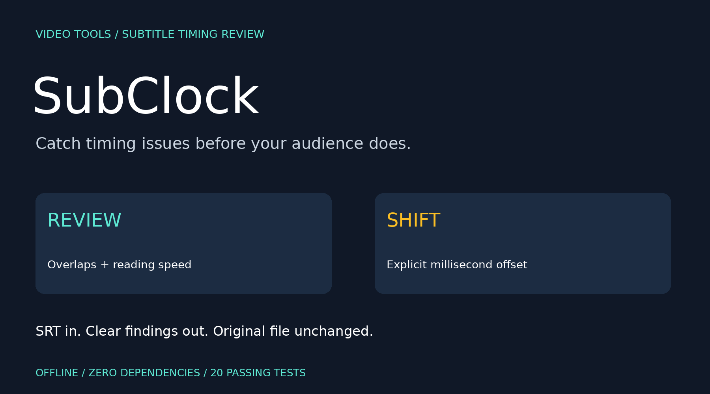
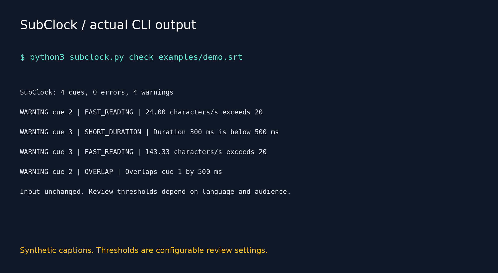

# SubClock



  

**Review subtitle timing before your audience has to.**

SubClock is a small offline SRT utility for video creators, translators and editors. It finds overlapping captions, invalid durations, duplicate cue numbers, out-of-order entries, short display times and high reading-speed estimates. It can also shift every cue by an explicit number of milliseconds into a new file.

No video upload, account, speech recognition, model or third-party Python package is required. This is a focused timing-review tool, not a new subtitle format or an automatic transcription service.

## Quick start

Install Python 3.10+ and download or clone this repository. From its directory:

```bash
python3 subclock.py check examples/demo.srt
python3 subclock.py check examples/demo.srt --json
python3 subclock.py check examples/demo.srt --html review.html
python3 subclock.py shift examples/demo.srt --offset-ms 750 --output synced.srt
python3 -m unittest discover -v
```

On Windows, substitute `py -3` if `python3` is unavailable. No pip installation is necessary. Open generated HTML locally in a browser. Output paths must not already exist; choose a new filename when rerunning report or shift commands.

## Actual demo result

```text
SubClock: 4 cues, 0 errors, 4 warnings
WARNING cue 2 | FAST_READING | 24.00 characters/s exceeds 20
WARNING cue 3 | SHORT_DURATION | Duration 300 ms is below 500 ms
WARNING cue 3 | FAST_READING | 143.33 characters/s exceeds 20
WARNING cue 2 | OVERLAP | Overlaps cue 1 by 500 ms
Input unchanged. Review thresholds depend on language and audience.
```

The example contains synthetic English captions and an Arabic caption. Included artifacts: [input](examples/demo.srt), [shifted copy](examples/shifted.srt), [HTML review](examples/review.html). Download the HTML file to view it in a browser.

## Two separate operations

| Command | Purpose | Changes |
| --- | --- | --- |
| `check` | Report issues and reading estimates | Reads source only; optional new HTML report |
| `shift` | Move all cues by a user-selected offset | Creates a new SRT; input unchanged |

A positive offset displays captions later, a negative offset earlier. For example, `--offset-ms=-1500` moves them 1.5 seconds earlier. Negative resulting timestamps are refused rather than clipped. The tool does not guess your audio offset, resolve overlaps or rewrite text. A global shift preserves existing overlap and reading-speed issues.

## Review rules

| Rule | Level | Meaning |
| --- | --- | --- |
| `INVALID_DURATION` | Error | End is not after start |
| `DUPLICATE_NUMBER` | Error | Cue number repeats |
| `OUT_OF_ORDER` | Warning | Start is earlier than the previous file entry |
| `OVERLAP` | Warning | Cue intersects an earlier valid interval |
| `SHORT_DURATION` | Warning | Display time is below configured minimum |
| `FAST_READING` | Warning | Estimated characters per second exceeds threshold |
| `EMPTY_TEXT` | Warning | No visible text after HTML-style tag stripping |
| `LONG_GAP` | Info | Uncovered interval exceeds configured gap threshold |

Overlap detection sorts valid intervals and tracks the running maximum end, so a long earlier caption cannot be hidden by a short neighboring cue. It reports at most one overlapping earlier cue per current cue, not every overlapping pair. Cues touching at an endpoint do not overlap. Invalid-duration cues are excluded from interval overlap/gap analysis.

Defaults: 20 characters/second, minimum 500 ms, and long gaps greater than 5000 ms. These are configurable review settings, not universal accessibility standards. Different languages, audiences and platforms require different choices.

```bash
python3 subclock.py check examples/demo.srt --max-cps 17 --min-ms 700 --gap-ms 3000
python3 subclock.py check examples/demo.srt --fail-on warning
python3 subclock.py check examples/demo.srt --fail-on never --json > report.json
```

CPS strips HTML-style tags, decodes entities, collapses whitespace and counts Unicode code points including spaces and punctuation. It does not count grapheme clusters, spoken words or language-specific reading difficulty. Empty/invalid-duration cues have no CPS estimate when duration is nonpositive. Unknown text markup is not interpreted as a subtitle renderer would.

## Supported input

UTF-8 (optional BOM), LF/CRLF/CR newlines, positive numeric cue identifiers, and strict timing lines in the form:

```srt
1
00:00:01,000 --> 00:00:03,000
Hello, world.
مرحبا بالعالم
```

Hours require at least two digits; minutes and seconds range from 00 to 59; milliseconds require three digits and a comma. Blank lines separate cues. Nonsequential unique identifiers are supported and preserved; duplicates are review errors and prevent shifting.

Not supported: WebVTT, SSA/ASS files, positioning suffixes on timing lines, dot-separated milliseconds, non-UTF-8 encodings, embedded blank lines inside caption text or repairing malformed input. Syntax problems stop parsing with an input error. Text is preserved during shifts, but line endings are normalized to LF and the file is written as UTF-8 without BOM. A trailing newline and normalized blank separators are emitted.

## Reports and exits

`--json` prints machine-readable findings, per-cue millisecond timestamps, durations, visible-character counts, CPS estimates, text and threshold settings. `--html` writes a self-contained escaped review report with no JavaScript or remote assets. Reports contain subtitle text, so review them before sharing. Included data is synthetic.

| Exit | Meaning |
| --- | --- |
| 0 | Successful shift, or check below selected failure threshold |
| 1 | Check findings meet the `--fail-on` threshold |
| 2 | Invalid input/threshold, failed shift or output I/O error |

Default `--fail-on error` ignores warnings for exit status. `warning` fails on warnings or errors; `never` does not fail on findings, but malformed input still returns 2. Info-only long gaps do not fail checks. Existing output files and symlinks are refused through exclusive creation. A disk/write failure may leave a partial new file, but existing files are never overwritten.

## Validation

20 standard-library tests cover Unicode/BOM/CRLF parsing, multiline round trips, invalid syntax, missing cue numbers, empty input, exact shifts, negative-timestamp refusal, invalid durations, nested overlaps, touching intervals, file ordering, HTML/entity stripping, inline tag boundaries, reading-speed warnings, duplicate numbers, empty visible text, long gaps, escaped HTML, large-hour timestamps and CLI exit/overwrite behavior.

## Limits

No audio/video decoding, waveform inspection, alignment estimation, translation, transcription, automatic overlap repair, styling preview or accessibility certification. Files are loaded in memory. Warnings are review prompts, not proof that captions are wrong. The HTML report displays escaped text, not rendered subtitle styles.

## Launch kit



[Arabic and English launch drafts](POST.md).

Suggested topics: `subtitles`, `srt`, `video-tools`, `python`, `accessibility`, `cli`, `offline`, `captioning`.

Search phrases: SRT timing checker, subtitle overlap review, subtitle reading speed, shift SRT milliseconds.
